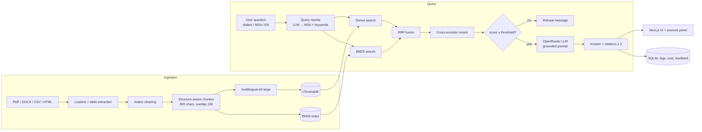

# 📚 RAG Hackathon — IEEE Bethlehem University

> نظام RAG كامل (Retrieval-Augmented Generation) يجيب عن أسئلة المستخدمين **بالعربية (فصحى + لهجة) والإنجليزية** اعتماداً فقط على مستندات موثوقة، **مع ذكر المصدر ورقم الصفحة**، ويرفض الإجابة بوضوح عند غياب المعلومة بدل الهلوسة.

**المشكلة:** معلومات طالب جامعة الخليل موزعة على عشرات صفحات الأقسام ومئات ملفات PDF (خطط دراسية، وصف مساقات، قبول، رسوم)، فتتكرر الأسئلة نفسها على المرشدين الأكاديميين كل فصل.
**المستخدم:** طلبة جامعة الخليل، والطلبة الجدد، والمرشدون الأكاديميون.
**الحل:** «مُرشد الخليل» — مرشد أكاديمي يجيب بالعامية أو الفصحى عن الساعات والمتطلبات السابقة ووصف المساقات وشروط القبول، وكل إجابة مرتبطة بملفها ورقم المساق.

## 🗂️ البيانات

المصدر: الموقع الرسمي لجامعة الخليل (hebron.edu)، سُحب لأغراض تعليمية (فرع `claude/magical-cerf-dpnkye`). حوّلناه إلى قاعدة معرفة بلا تكرار (`backend/scripts/prepare_hebron.py`):

| المجلد في `backend/data/raw/` | المحتوى | العدد |
|---|---|---|
| `plans/` | خطة دراسية لكل تخصص وسنة: ملخص المتطلبات + جداول المساقات (رقم، اسم، ساعات، متطلب سابق) | 175 خطة |
| `courses/courses.json` | سجل لكل مساق مرة واحدة: الساعات، المتطلب السابق، الوصف، الخطط التي يرد فيها | 2,184 مساقاً |
| `departments/` | صفحات الأقسام: نبذة، أهداف، مجالات عمل الخريجين، الخطة الاسترشادية | 36 قسماً |
| `general/` | القبول وشروطه، الرسوم، المنح والقروض، الطلبة الجدد، الكليات | 8 |

قرارات: حذف وصف المساقات المكرر داخل كل خطة (12MB ← 4.5MB، ~5,200 مقطعاً)، إضافة عنوان الخطة ورأس الجدول لكل مقطع من جدول طويل، وتخزين التضمينات (embeddings) في كاش حتى لا تُعاد عند كل فهرسة.
قيود معروفة: الخطط «الإرشادية» (Advisory) مستخرجة آلياً من PDF وفيها أخطاء أحياناً في ترتيب الأعمدة؛ خطط التمريض والقبالة 2023 صور ممسوحة بلا نص.

---

## ✨ المزايا

| الطبقة | ما الذي بنيناه | لماذا |
|---|---|---|
| **الاستيعاب** | PDF (مع استخراج الجداول كـ Markdown)، DOCX (بترتيب المستند)، TXT/MD، HTML، CSV (كل صف سجل)، JSON | المستندات الحقيقية فيها جداول وأسئلة شائعة |
| **تنظيف العربية** | NFKC (يعالج أشكال الحروف في PDF)، إزالة التطويل والمحارف الخفية، توحيد الألف/الياء/التاء المربوطة للبحث | نصوص PDF العربية تخرج "مكسّرة" بدون هذا |
| **التقطيع** | حدود صلبة عند العناوين/المواد (المادة 5، الفصل…)، ثم فقرات → أسطر → جمل عربية → كلمات، 900 حرف + تداخل 150، الجداول لا تُقطع، عنوان القسم يُضاف للمقطع | دقة أعلى + اقتباس نظيف (المادة كاملة في مقطع واحد) |
| **الـ Embeddings** | `intfloat/multilingual-e5-large` محلياً عبر fastembed (ONNX) | من أقوى النماذج المفتوحة للعربية، مجاني، المستندات لا تغادر الجهاز |
| **قاعدة المتجهات** | **ChromaDB** دائمة (cosine) + metadata (source, page, section, category) | فلترة حسب التصنيف/السنة/الإصدار |
| **الاسترجاع** | **Hybrid**: Dense + BM25 (مع تطبيع عربي) → **RRF** → **Reranker** متعدد اللغات (`jina-reranker-v2-base-multilingual`) | BM25 يلتقط أرقام المواد والرموز، الـ embeddings تلتقط المعنى واللهجة، الـ reranker يرفع Precision@k |
| **إعادة صياغة السؤال** | LLM يحوّل سؤال اللهجة/المحادثة إلى سؤال فصيح مستقل + كلمات مفتاحية + كشف خارج النطاق | «ليش ورق الزيتون بصفر؟» ← مصطلحات المستندات الفصحى |
| **التوليد** | Gemini (الطبقة المجانية) عبر واجهة متوافقة مع OpenAI، مع نموذج احتياطي تلقائي وحارس `FREE_ONLY`، Prompt مؤرَّض صارم، استشهادات `[1]`، رفض صريح، معالجة التعارض (الأحدث أولاً)، حماية من prompt injection داخل المستندات | لا هلوسة، كل معلومة لها مصدر |
| **بوابة الثقة** | إذا كانت أعلى درجة صلة < العتبة → رفض بدون استدعاء الـ LLM | رفض موثوق للأسئلة خارج النطاق + توفير تكلفة |
| **التقييم** | Hit@k، Precision@k، Recall@k، MRR، Faithfulness و Correctness (LLM-as-judge)، Citation rate، Refusal accuracy + تقرير Markdown | معيار التقييم + كسر التعادل |
| **المنتج** | Next.js 16 + shadcn/ui + RTL كامل + وضع ليلي، دردشة متدفقة (SSE) مع لوحة مصادر تفاعلية، تسجيل دخول (JWT)، سجل محادثات، تقييم 👍👎 | بونص المنتج المتكامل + UX |
| **لوحة الإدارة** | رفع مستندات (سحب وإفلات)، إعادة فهرسة، تحليلات بـ **AntV G2** (أسئلة/يوم، نسبة الرفض، التكلفة لكل إجابة، الأسئلة بلا إجابة)، صفحة تقييم، **مختبر استرجاع** يعرض درجات كل مرحلة | بونص الميزات الإنتاجية |
| **الأمان** | مفاتيح في `.env` فقط، bcrypt + JWT، صلاحيات admin، rate limit، إخفاء البيانات الشخصية (هاتف/بريد/هوية) قبل حفظ السجلات، فحص امتداد وحجم الملفات | بند الأمان والخصوصية |
| **وضع الطوارئ** | `LLM_MOCK=true` يعطي إجابات استخراجية من المصادر بدون إنترنت | إذا انقطع النت وقت العرض |

## 🏗️ المعمارية



```
.
├── backend/
│   ├── app/
│   │   ├── config.py              # كل الإعدادات (env) + تحميل domain.yaml
│   │   ├── ingestion/             # loaders, arabic, chunker, pipeline
│   │   ├── retrieval/             # embeddings, vectorstore (Chroma+BM25), reranker, retriever
│   │   ├── generation/            # llm (OpenRouter), prompts, generator (citations/refusal)
│   │   ├── evaluation/            # metrics + runner
│   │   ├── api/                   # FastAPI routes: chat, documents, auth, admin
│   │   └── core/                  # db (SQLite), security (JWT, rate-limit, PII)
│   ├── config/domain.yaml         # ⭐ كل ما يخص المشكلة — غيّره يوم الهاكاثون
│   ├── data/raw/                  # ⭐ ضع المستندات هنا (اسم المجلد الفرعي = category)
│   ├── data/eval/eval_set.json    # ⭐ أسئلة الاختبار المرجعية
│   ├── scripts/                   # ingest, evaluate, inspect_doc, check_setup, cost_calculator
│   └── tests/
├── frontend/                      # Next.js + shadcn/ui + G2
└── docs/                          # خطة اليوم، أدلة المشاكل، قوالب البزنس والعرض
```

## 🚀 التشغيل (للمحكّم — بدون مساعدة الفريق)

المتطلبات: Python 3.11+، Node 20+، مفتاح **مجاني** لـ [Google Gemini](https://aistudio.google.com/apikey). المشروع يستخدم **واجهات مجانية فقط** (`FREE_ONLY=true` يمنع أي موديل مدفوع).

```bash
git clone <repo> && cd RAG-Hacathon-IEEE
make setup                 # venv + npm install + ينسخ .env.example إلى .env
# عدّل .env وضع LLM_API_KEY (مفتاح Gemini المجاني من aistudio.google.com/apikey)
make models                # تنزيل نموذج الـ embeddings والـ reranker (مرة واحدة)
make reset                 # فهرسة المستندات في backend/data/raw
make dev                   # API على :8000 والواجهة على :3000
```

افتح http://localhost:3000 (صفحة الهبوط، والمحادثة على `/chat`؛ الواجهة تمرّر `/api` للـ backend تلقائياً) — لوحة الإدارة: http://localhost:3000/admin (البريد وكلمة المرور من `.env`: `ADMIN_EMAIL` / `ADMIN_PASSWORD`).
توثيق الـ API التفاعلي: http://localhost:8000/docs

<details><summary>بدون make (Windows)</summary>

```bash
cd backend
python -m venv .venv && .venv\Scripts\activate
pip install -r requirements-dev.txt
python -m scripts.download_models
python -m scripts.ingest --reset
uvicorn app.main:app --reload --port 8000
# terminal ثاني
cd frontend && npm install && npm run dev
```
</details>

أو بـ Docker: `docker compose up --build`

## 📊 التقييم

```bash
make eval-fast             # استرجاع فقط (مجاني، ثوانٍ): Hit@k, Precision@k, Recall@k, MRR
make eval TAG=final        # + Faithfulness, Correctness, Citation rate, Refusal accuracy
```
النتائج: `backend/data/eval/results/*.md` وفي لوحة الإدارة ← التقييم.

<!-- TODO: الصق جدول النتائج النهائي هنا + جدول "قبل/بعد" التحسينات -->
| الإعداد | Hit@5 | Precision@5 | MRR | Faithfulness | Refusal acc. |
|---|---|---|---|---|---|
| Baseline (dense only, chunk 900) | | | | | |
| + BM25 hybrid | | | | | |
| + Reranker | | | | | |
| + Query rewrite (dialect) | | | | | |

**تحليل الأخطاء:** _(أسوأ سؤال، لماذا فشل، ماذا غيّرنا، الأثر)_

## 🔒 الأمان والخصوصية وقابلية التوسع

- المفاتيح في `.env` فقط (`.env` في `.gitignore`)، و`.env.example` بدون قيم سرية.
- كلمات المرور bcrypt، وجلسات JWT، ومسارات الإدارة محمية بدور `admin`.
- Rate limiting لكل IP، وفحص نوع وحجم الملفات المرفوعة، وتنظيف أسماء الملفات.
- **الخصوصية:** الـ embeddings تعمل محلياً (المستندات لا تُرسل لطرف ثالث للفهرسة)، والأسئلة تُحفظ في السجلات بعد إخفاء الهاتف/البريد/أرقام الهوية. يُرسل للـ LLM فقط أعلى 5 مقاطع ذات صلة.
- **التوسع:** Chroma يتحمل مئات آلاف المقاطع على جهاز واحد؛ للتوسع: Chroma server/Qdrant، تشغيل الـ API بعدة workers خلف load balancer، Redis للـ rate-limit والـ cache، وتخزين مؤقت للأسئلة المتكررة. التكلفة لكل إجابة محسوبة في لوحة الإدارة و`make cost`.

## 🤖 الإفصاح عن استخدام الذكاء الاصطناعي

<!-- عدّلها لتكون صادقة ودقيقة -->
استخدمنا Claude (Claude Code) للمساعدة في بناء الهيكل الأساسي للمشروع (الـ boilerplate، مكونات الواجهة، والاختبارات) قبل الهاكاثون. خلال الهاكاثون استخدمنا الذكاء الاصطناعي في: _(…)_.
القرارات التصميمية (استراتيجية التقطيع، اختيار النماذج، عتبة الرفض، مجموعة التقييم) اتخذها الفريق وقاسها بالأرقام، وكل عضو قادر على شرح أي جزء من الكود.
النظام نفسه يستخدم Gemini المجاني (`LLM_MODEL` في `.env`) و`multilingual-e5-large` و`jina-reranker-v2-base-multilingual`.

## 👥 الفريق

| الاسم | الدور |
|---|---|
| | RAG / Backend |
| | Frontend / UX |
| | Business & Pitch |
